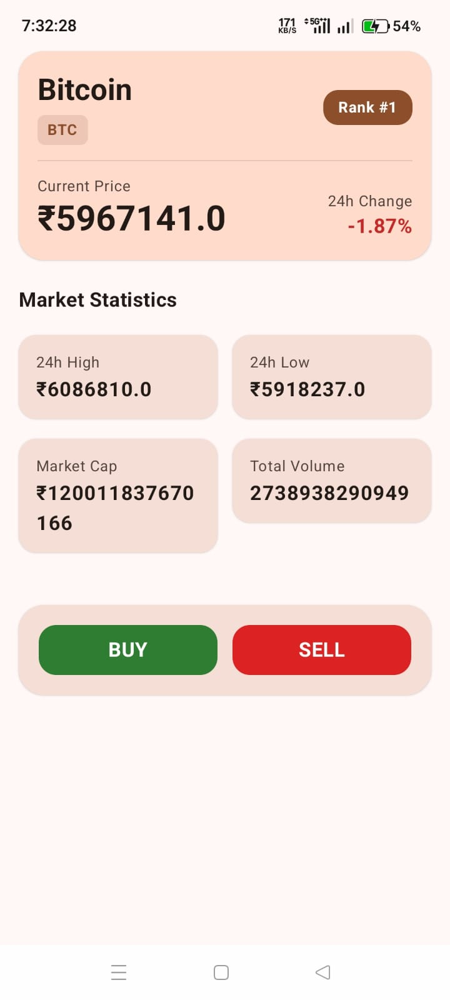
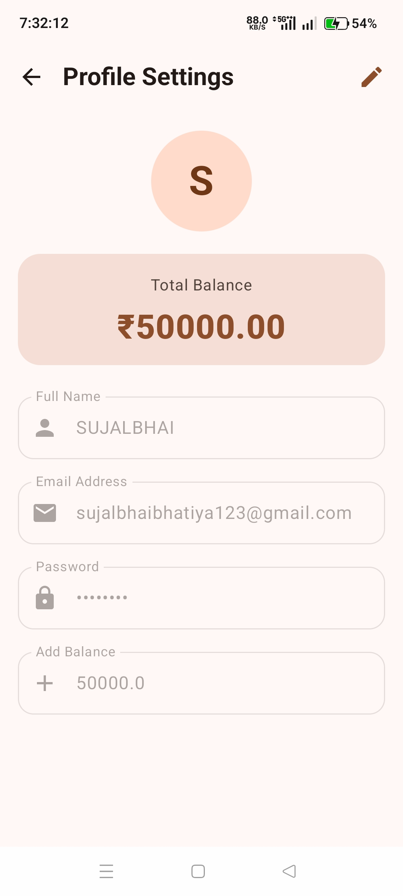
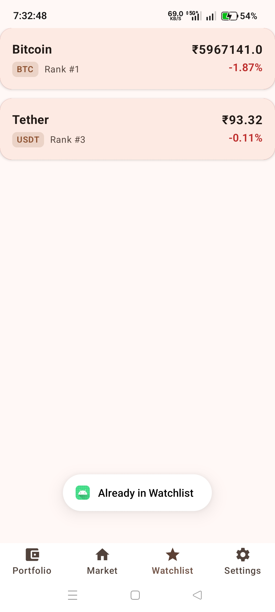

# 🪙 Crypto Paper Trading App

A cryptocurrency **paper-trading** Android app built with **Kotlin** and **Jetpack Compose**.
Prices are **real and live** (CoinGecko API), but the money is **virtual**. Practice buying and selling crypto, track your portfolio and manage a watchlist without risking a rupee.

> ⚠️ Educational project. All balances are virtual and no real trades happen. Not affiliated with CoinGecko.

---

## 📸 Screenshots

| Market | Coin Detail | Portfolio | Watchlist |
|:---:|:---:|:---:|:---:|
|  |  |  |  |

---

## ✨ Features

### ✅ Working
- **Live market data** from the CoinGecko API (real-time prices)
- **Coin list and coin detail** screens
- **Create account** with a starting virtual balance of your choice
- **Edit profile details** at any time
- **Add virtual money** to your balance directly
- **Buy crypto** with virtual balance at the real current price
- **Portfolio** showing your account and balance
- **Watchlist** with swipe gestures: swipe to **add** a coin from the market list, swipe to **remove** it from the watchlist
- Data stored locally in **three separate Room databases** (user, crypto, transactions)

### 🚧 In Progress
- [ ] Sell flow (partially done)
- [ ] Transaction history
- [ ] Report / profit-loss summary

---

## 🧭 App Structure

Bottom navigation with 4 tabs:

| Tab | Purpose |
|---|---|
| **Market** | Live coin list, search, open coin detail |
| **Portfolio** | Account, balance and holdings |
| **Watchlist** | Your saved coins (swipe to add / remove) |
| **Settings** | Profile and app settings |

Navigation is **nested**: a root `NavHost` (main screen and coin detail) with an inner `NavController` for the bottom tabs, so the bottom bar hides on the detail screen.

---

## 🏗️ Architecture

**MVVM + Clean Architecture**, split into three layers:

```
app/
├── data/            # Retrofit API, DTOs, Room (3 databases), repository implementations
├── domain/          # Models, repository interfaces, use cases
└── presentation/    # Compose screens, ViewModels, navigation, theme
```

- UseCases return `Result<Unit>`, with input validation inside the domain layer
- State flows from Room / API through `Flow` and `StateFlow` into Compose

---

## 🛠️ Tech Stack

| Area | Tech |
|---|---|
| Language | Kotlin |
| UI | Jetpack Compose, Material 3 |
| Architecture | MVVM, Clean Architecture |
| Dependency Injection | Hilt |
| Networking | Retrofit, CoinGecko API |
| Local Storage | Room (3 databases), DataStore Preferences |
| Async | Coroutines, Flow, StateFlow |
| Navigation | Navigation Compose (nested) |

---

## 🚀 Getting Started

1. Clone the repo
   ```bash
   git clone https://github.com/sujals-android-world/Coingecko_API.git
   ```
2. Open in **Android Studio** and let Gradle sync
3. Run on an emulator or a real device

> If you use a CoinGecko API key, add it to `local.properties` and never commit it.

### 📦 Download APK
Get the latest APK from the [**Releases**](../../releases) section.

---

## 🔮 Roadmap

- [ ] Complete sell flow
- [ ] Full transaction history
- [ ] Profit / loss report
- [ ] Price charts on coin detail

---

## 👨‍💻 Author

**Sujalbhai Popatbhai**
Android Developer (Kotlin, Jetpack Compose)

- GitHub: [sujals-android-world](https://github.com/sujals-android-world)
- Email: sujalbhaibhatiya123@gmail.com

---

⭐ If you like this project, give it a star!
